<table width="100%">
<tr>
<td width="68%" valign="middle">

PROFILE SIGNAL · AROMAL-M-B

<h1>AROMAL MB</h1>
<h2>AI / ML Engineer</h2>

Machine learning · Computer vision · Agentic AI

<strong>Building useful systems from data, models, and APIs.</strong>

Chalakudy, Kerala, India · B.Tech Computer Science Engineering

<a href="https://portfolio-delta-five-46.vercel.app/">Portfolio</a> · <a href="https://github.com/Aromal-m-b">GitHub</a> · <a href="https://www.linkedin.com/in/aromal-mb/">LinkedIn</a>

</td>
<td width="32%" valign="middle" align="center">

</td>
</tr>
</table>

---

### `01 / THE SHORT VERSION`

I’m an AI/ML Engineer with hands-on experience taking machine-learning work from data preparation and evaluation to application APIs. My projects span CNN-based computer vision, LLM and agent workflows, and tools that put model output to use.

| Machine learning | Agentic AI | Computer vision | Application delivery |
| :--- | :--- | :--- | :--- |
| Clustering, classification, evaluation | LangChain, LangGraph, RAG | PyTorch, OpenCV, YOLOv8 | FastAPI, REST, PostgreSQL |

### `02 / SKILLS & TOOLKIT`

 

| Area | Skills and tools |
| :--- | :--- |
| **Programming** | Python, SQL, Git/GitHub, data structures and algorithms fundamentals |
| **Machine learning** | Scikit-learn, supervised and unsupervised learning, clustering, classification, regression, feature engineering, model selection, cross-validation, model training and evaluation, hyperparameter tuning, performance optimization |
| **Data work** | Pandas, NumPy, statistics, exploratory data analysis, data cleaning, validation and preprocessing, Matplotlib, Seaborn |
| **Deep learning & vision** | PyTorch, TensorFlow Lite, CNNs, neural networks, backpropagation, YOLOv8, CLIP, OpenCV |
| **Generative AI & agents** | LangChain, LangGraph, AI agents, RAG pipelines, prompt engineering, structured outputs, Gemini, Groq, Ollama, LangSmith |
| **APIs & databases** | FastAPI, REST APIs, Django REST Framework, Express, PostgreSQL, model integration, real-time inference |
| **Developer tools** | Jupyter Notebook, Postman, Jira, version control, documentation, coding standards |
| **Ways of working** | Collaboration, communication, analytical problem-solving, critical thinking, troubleshooting |

### `03 / SELECTED PROJECTS`

| Project | Build notes |
| :--- | :--- |
| [Rasengana](https://github.com/Aromal-m-b/Rasengana) | ASL alphabet classification with a PyTorch CNN. Trained on a 1M+ image dataset, reached 90% accuracy, and served real-time inference through FastAPI. |
| [CityMind](https://github.com/Aromal-m-b/Smart-City-using-IOT) | IoT and edge vision pipeline using TensorFlow Lite, YOLOv8, and CLIP for vehicle counting and anomaly alerts, with a React dashboard, traffic-analysis agent, and reinforcement-learning signal coordination. |
| [Pharma App](https://github.com/Aromal-m-b/Pharma-App) | Complaint intake for PDF/OCR, DOCX, and ODT documents. Gemini and LangGraph with Groq Llama 3.3 extract and validate 15 QA fields, follow up on missing details, and produce Clinical/Safety reports with CAPA recommendations using FastAPI/Express and PostgreSQL. |
| [Mugiwara](https://github.com/Aromal-m-b/Mugiwara) | Early-learning screening prototype using speech and text tasks, Gemini, and LangGraph to prepare a unified assessment summary for children aged 3–6. |
| [Ghost](https://github.com/Aromal-m-b/Ghost) | Python deletion-audit agent that checks distributed data stores for residual user data and builds evidence-based remediation plans. |
| [Tele-Caller](https://github.com/Aromal-m-b/Tele-Caller) | Voice support assistant with knowledge retrieval, streaming conversation, and confirmed customer-service workflows. |

### `04 / EXPERIENCE & EDUCATION`

- **AI/ML Software Trainee · Spectrum Softtech Solutions Pvt. Ltd.** — testing, evaluating, and documenting model performance across datasets; Aug 2026–present.
- **Data Science & ML Intern · GALTech Technologies Pvt. Ltd.** — analyzed 50,000+ customer records and built a segmentation model associated with a 15% improvement in targeted campaign response; Jun–Jul 2025.
- **B.Tech, Computer Science Engineering · College of Engineering, Poonjar (KTU)** — 2022–2026 · CGPA 7.88.

**Recognition:** Top 5 finalist, IHRD AI Samasya / ICGAIFE 3.0 · First runner-up, PromptCraft Gen AI Hackathon · First runner-up, IHRD Tharang 2K25 Project Expo · Second runner-up, Hackengers 2024.

### `05 / RECENTLY PUSHED REPOSITORIES`

Public repositories with recent pushes, refreshed automatically every six hours.

<!--START_SECTION:repos-->
- [**Leet-Code**](https://github.com/Aromal-m-b/Leet-Code) · `Python` · ⭐ 1 · pushed Nov 04, 2026 — a repository for challenging problems and solutions
- [**Tele-Caller**](https://github.com/Aromal-m-b/Tele-Caller) · `Python` · ⭐ 0 · pushed Nov 03, 2026 — An autonomous Tele Calling assistant that assists with managing customer calls
- [**portfolio**](https://github.com/Aromal-m-b/portfolio) · `JavaScript` · ⭐ 0 · pushed Oct 31, 2026 — Aromal MB's React portfolio — AI/ML, agentic AI, and computer vision
- [**Spectrum-Machine-Test**](https://github.com/Aromal-m-b/Spectrum-Machine-Test) · `Jupyter Notebook` · ⭐ 0 · pushed Oct 29, 2026 — No description yet\.
- [**Ghost**](https://github.com/Aromal-m-b/Ghost) · `Python` · ⭐ 0 · pushed Oct 26, 2026 — Ghost is an agentic data cleaner in the moder day systems we are using multiple records and datasets to keep the customer records which increases t…
- [**Queens**](https://github.com/Aromal-m-b/Queens) · `TypeScript` · ⭐ 0 · pushed Oct 07, 2026 — No description yet\.
<!--END_SECTION:repos-->

### `06 / RECENT PUBLIC ACTIVITY`

<!--START_SECTION:activity-->
- `PUSH` · **1 commit** to [Aromal-m-b/Leet-Code](https://github.com/Aromal-m-b/Leet-Code) · Nov 02, 2026
- `PUSH` · **1 commit** to [Aromal-m-b/Leet-Code](https://github.com/Aromal-m-b/Leet-Code) · Nov 01, 2026
- `PUSH` · **1 commit** to [Aromal-m-b/Tele-Caller](https://github.com/Aromal-m-b/Tele-Caller) · Oct 31, 2026
- `PUSH` · **1 commit** to [Aromal-m-b/Tele-Caller](https://github.com/Aromal-m-b/Tele-Caller) · Oct 30, 2026
- `PUSH` · **1 commit** to [Aromal-m-b/portfolio](https://github.com/Aromal-m-b/portfolio) · Oct 31, 2026
- `PUSH` · **1 commit** to [Aromal-m-b/Tele-Caller](https://github.com/Aromal-m-b/Tele-Caller) · Oct 29, 2026
<!--END_SECTION:activity-->

### `07 / CONTRIBUTION SIGNAL`

BUILD · LEARN · REPEAT — KERALA, INDIA

